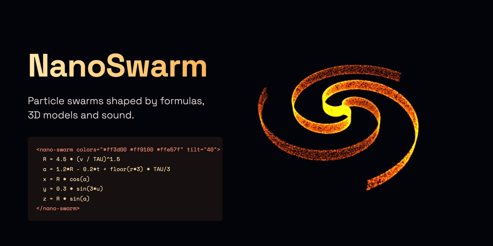

# NanoSwarm

[](https://github.com/eladiomejutogracia/nanoswarm/actions/workflows/ci.yml)
[](https://eladiomejutogracia.github.io/nanoswarm/)
[](LICENSE)

Particle swarms shaped by **formulas**, **3D models** and **sound** — as one HTML element.

[](https://eladiomejutogracia.github.io/nanoswarm/)

```html
<script src="https://eladiomejutogracia.github.io/nanoswarm/nano-swarm.js"></script>

<nano-swarm colors="#ff3d00 #ff9100 #ffe57f" tilt="40" style="height: 100vh">
  R = 4.5 * (v / TAU)^1.5
  a = 1.2*R - 0.2*t + floor(r*3) * TAU/3
  x = R * cos(a)
  y = 0.3 * sin(3*u)
  z = R * sin(a)
</nano-swarm>
```

That is the picture above: the header image is a screenshot of
[`web/public/preview.html`](web/public/preview.html), which is this snippet and nothing else.
`v` walks each particle outwards, `r` drops it into one of three arms, `t` turns the whole thing.

The formula is the element's text. Everything else is an attribute. That's the whole idea.
**Give the element a height** (here `style="height: 100vh"`) — on its own it is a 240 px strip.
The script is served from the [playground](https://eladiomejutogracia.github.io/nanoswarm/) site and always
tracks the latest version; for a fixed version, download `nano-swarm.js` from a
[release](https://github.com/eladiomejutogracia/nanoswarm/releases) and host it yourself.
The script includes three.js; it picks the GPU when the browser can and the CPU when it can't.

**What it costs.** That one `<script>` is 767 kB raw and **196 kB gzipped**, three.js included — there is
nothing else to load. From npm, where three.js is your own dependency, the module is 24 kB gzipped.
(Measured on `v1.0.0-alpha.1` with `npm run build && gzip -9 -c dist/nano-swarm.js | wc -c`.)

The [playground](web/) is a live editor for one of these elements: every control just edits it,
and the **</> Code** panel shows it as it is. Save it as a page or copy a link.

## Formulas

A formula is a list of lines `name = expression`. There are two kinds — what you write decides which.

### Shapes: where each particle goes

Write `x`, `y`, `z`. Every particle has its own `u` and `v` (0 → 2π, evenly spread) and `r` (random, 0 → 1).

```
# A sphere that breathes with the music
h = v / PI - 1
ring = sqrt(1 - h*h)
R = 3.5 + bass * 1.5
x = R * ring * cos(u)
y = R * h
z = R * ring * sin(u)
```

### Motions: how a point moves

Write `dx`, `dy`, `dz` — the velocity of a point at `x, y, z`. Particles keep travelling along it,
which is exactly what strange attractors are:

```
dx = 10 * (z - x)
dz = x * (28 - y) - z
dy = x * z - 8/3 * y
```

There is no time step or scale to set. NanoSwarm traces the motion once, measures where it lives and
how fast it moves, and frames it with a comfortable pace. If it runs off to infinity, or stops at a
single point, you get a message saying so.

### In both

| | |
|---|---|
| `c = …` | Optional color, 0 → 1 along `colors`. Without it, colors run bottom → top. |
| `t` | Time in seconds (scaled by `speed`) |
| `bass` `mid` `treble` `level` | Sound energy, 0 → 1 |
| `spectrum(k)` | Loudness at frequency `k`: 0 = deep bass → 1 = high treble |
| `noise(x, y, z)` | Smooth randomness, −1 → 1 — same pattern on CPU and GPU |
| other names | Helpers for later lines |

**Functions:** `sin cos tan asin acos atan sqrt abs exp log floor ceil fract sign min max pow mod step clamp mix smoothstep noise spectrum`
**Constants:** `PI TAU E` · **Operators:** `+ - * / ^` · **Comments:** `#` or `//`

Formulas are parsed into an AST and compiled to JavaScript (CPU) or GLSL (GPU) from that AST only —
the text is never run directly, so formulas from a shared link are safe.

## Attributes

| Attribute | |
|---|---|
| `title` | A name for the creation |
| `model="robot.glb"` | Use a 3D model instead of a formula (GLB, GLTF, OBJ, STL, PLY): a file next to the page, or a full URL — another site must allow cross-origin requests (CORS), as raw.githubusercontent.com does. An animated GLB/GLTF plays its first animation in a loop |
| `animation="Walk"` | Which animation of the model to play, by name (default: the first) |
| `colors="#a #b #c"` | Up to three colors, bottom → top (or `c` = 0 → 1) |
| `background="#000"` | Background color |
| `solid` | Opaque, shaded particles — gives models volume |
| `bloom` | Glow on bright areas (GPU only); `bloom="0.8"` for a strength |
| `speed="2"` | Pace: multiplies `t` for shapes, travel speed for motions, and playback of animated models (`0` freezes) |
| `tilt="40"` | Camera height in degrees: 0 side view, 90 top-down |
| `audio="song.mp3"` / `audio="mic"` | Sound to react to — starts on the first click (browser rule) |
| `sensitivity="1.5"` | How strongly sound moves things |
| `particles="60000"` | The most particles to draw: a ceiling, not an order — a slow device still lowers it (default: chosen for the device). The CPU renderer tops out at 40,000 |
| `renderer="cpu"` | Force `gpu` or `cpu` (default: automatic) |
| `no-pointer` | The pointer doesn't push particles |
| `no-rotate` | The camera doesn't orbit on its own |

Bad values fall back to defaults instead of breaking the page. Change any attribute at any time and
the swarm follows — particles fly to new shapes.

## Examples

[`examples/`](examples/) holds the built-in creations, grouped in `sound/`, `shapes/` and `attractors/`.
Each one is a whole page: **download it and open it in a browser** and it runs, because it is exactly what
the playground's **Save .html** writes — a `<script>`, a height, and one `<nano-swarm>`. The gallery is
built from that folder, and the tests check that every example compiles, stays on screen and uses its
colors well. Add a file, and it shows up.

## With AI assistants

NanoSwarm ships an **Agent Skill** that works in both **Claude Code** and **GitHub Copilot** (agent mode,
CLI and cloud agent): it teaches the assistant the element and the formula language, and includes a
validator so the assistant checks its own work before showing it to you.

- **Install:** download [nanoswarm-skill.zip](https://eladiomejutogracia.github.io/nanoswarm/nanoswarm-skill.zip)
  and unzip it into `~/.claude/skills/` (both tools read that folder), or into your project's
  `.claude/skills/` or `.github/skills/`.
- **Then ask:** *"make me a nano-swarm that looks like a jellyfish pulsing with the bass"*.
- **Any other assistant:** point it at [llms.txt](https://eladiomejutogracia.github.io/nanoswarm/llms.txt),
  the same reference in one file.
- **Check a file yourself:** `node check.mjs shape.html` (the script is in the skill), or paste the element
  into the playground's **Paste HTML**.

The skill and `llms.txt` are generated from the code, so they always match the current version.

## JavaScript

The element is built on a small API you can use directly:

```js
import { createSwarm } from 'nanoswarm';

const swarm = createSwarm(container, {
    source: 'dx = -y\ndy = x\ndz = 0.1 * sin(t)',  // or { model: file }
    look: { colors: ['#ff3d00', '#ff9100', '#ffe57f'], style: 'solid' },
    speed: 1.5,
});
swarm.setAudio('mic');
```

`document.querySelector('nano-swarm').swarm` gives you the same object for an element.
Events: the element fires `swarm-load` once a formula or model is showing (then `swarm.animations`
lists the model's animations), and `swarm-error` (`event.detail` is the Error) for a bad formula, model or audio,
or a browser without WebGL. Failures are also written to the console, so a broken formula never looks like an
empty element. The full public surface, and what is deliberately left out, is in [API.md](API.md).

## GPU and CPU

`renderer` defaults to automatic: the GPU (GPGPU float textures; the formula runs once per particle
per frame in a small target pass) unless the browser lacks float render targets or vertex textures,
or renders in software. The CPU path uses plain `Float32Array` physics, no bloom, pixel ratio 1 —
capped at 40,000 particles. Measured at that cap: an animated jellyfish costs 13 ms per frame, a galaxy
7 ms, a Lorenz attractor 3 ms (Chromium 156, Intel i7-9750H, median of the update step without drawing;
the full table and the method are in [API.md](API.md)). The GPU path runs the same physics in a shader and
handles hundreds of thousands of particles — it has not been measured the same way, so no number is
claimed for it. Both share one physics model, so they look the same.

## Develop

```bash
npm run dev         # playground
npm test            # vitest
npm run typecheck
npm run build       # dist/nanoswarm.js (ES module, three.js peer) + dist/nano-swarm.js (drop-in)
npm run build:web   # playground → dist-web/
```

`main` is protected: changes arrive through pull requests, and **CI** must pass before they merge.

GitHub Actions: **CI** runs types, tests and both builds on every push, and on pull requests also
checks new dependencies for known vulnerabilities; **Playground** deploys `web/` to GitHub Pages;
**Release** runs when a release is published — bump `version` in `package.json`, merge, then
publish a release tagged `vX.Y.Z`: it attaches `nano-swarm.js` (pinned to that version) and the AI skill
to the release, and publishes to npm (needs an `NPM_TOKEN` repository secret). Pre-releases stay on GitHub.
CodeQL scans the code for security issues, and Dependabot proposes dependency updates every week.
Found a security problem? See [SECURITY.md](SECURITY.md).

```
src/
  element/   <nano-swarm>: the element, its vocabulary as plain data (markup.ts), the validator (check.ts)
  ai/        generates the AI skill and llms.txt from the code
  formula/   parser, JS + GLSL code generation, noise
  sources/   formulas, motions (flow calibration), models, particle params
  audio/     Web Audio input, bands + spectrum
  backends/  physics, GPU and CPU backends, backend selection
  runtime/   pointer, auto quality, camera tilt
  swarm.ts   the engine behind the element
examples/    the built-in creations, one page with one <nano-swarm> per file
.claude/skills/nanoswarm/   the AI skill (SKILL.md + check.mjs), generated
web/         the playground
```

## Contributing

Creations, examples and code are all welcome — see [CONTRIBUTING.md](CONTRIBUTING.md) and the
[code of conduct](CODE_OF_CONDUCT.md). Working with an AI agent? It will find [AGENTS.md](AGENTS.md).

## License

MIT — see [LICENSE](LICENSE). The playground's demo track and fox model come from others: the fox is
**[CC BY 4.0](https://creativecommons.org/licenses/by/4.0/)**, so if you reuse it you must credit it
too. Full details in [CREDITS.md](CREDITS.md); the playground carries the credit on the page itself.
